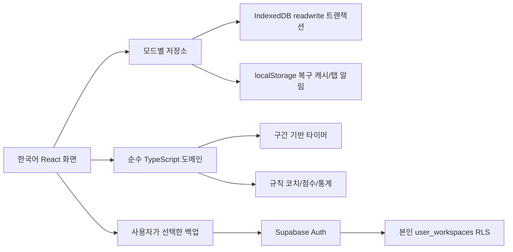

# 아키텍처

## 이번 구현의 범위

지시서의 단계 A를 중심으로, 단계 B/C의 서버 없이 가능한 분석·학습 확장을 구현했습니다. React + Vite + TypeScript 정적 배포를 선택했습니다. 브라우저 안에서 작동하는 분석에 Next.js/FastAPI를 중복 배치하지 않아 오프라인 로컬 시연과 테스트가 간단합니다. 이 선택은 전체 온라인 서비스와 Android 구현을 대체하지 않습니다.

## 파일 책임

- `src/domain.ts`: 타입, 입력 검증, 타이머 구간, 계획 겹침/날짜 경계, 통계, 코치, 점수, CSV.
- `src/store.tsx`: IndexedDB 직렬화 저장, 모드 분리, 캐시 및 다른 탭 갱신.
- `src/App.tsx`: 화면, 폼, 사용자 선택 흐름, 뽀모도로 시간 종료 감지.
- `src/cloud.ts`: 이메일 인증 및 명시적 스냅샷 업로드/다운로드/삭제. 기본 미연결.
- `supabase/migrations`: 선택 원격 저장소의 RLS와 후속 정상화 스키마.

## 타이머

진행 중에는 `runningSince`, 일시정지한 구간은 `segments`에 저장합니다. 표시용 interval은 실제 시간의 기준이 아닙니다. 종료는 동일 id 중복 저장을 방지합니다. 일별 합계는 각 구간과 날짜 범위의 교집합으로 산출해 자정과 일시정지를 반영합니다. 뽀모도로는 설정 길이를 상한으로 적용하므로 백그라운드 종료 감지가 늦어도 추가 공부 시간을 만들지 않습니다. 다음 집중/휴식 전환은 수동입니다.

IndexedDB 트랜잭션이 동일 모드의 변경을 직렬화해 동시에 두 탭에서 시작해도 한 타이머만 유지합니다. 캐시만으로 저장을 결정하지 않습니다. 기기 시각이 이전으로 변경되면 일시정지/재개에서 오류를 안내합니다. 절전·강제 종료 시 복구는 저장된 타임스탬프에 의존하며, 신뢰할 수 있는 서버 시각이나 조작 방지는 제공하지 않습니다.

## 로컬/온라인 경계

기본 저장 키는 `mindtrace:v1:demo`와 `mindtrace:v1:personal`입니다. 모드 변경은 데이터 이동이나 자동 업로드를 하지 않습니다. 선택 클라우드는 인증한 계정의 개인 스냅샷만 수동 백업합니다. 온라인 복원은 확인 후 개인 로컬 모드를 덮어쓰며 진행 중 타이머는 복원하지 않습니다. 원격 스냅샷과 로컬을 자동 병합하지 않습니다.

정상화된 과목/세션/그룹 테이블을 정의했지만 이 버전에서는 그룹 API/Realtime에 연결하지 않았습니다. 그룹 테이블은 RLS + 브라우저 권한 회수로 접근을 차단합니다. 두 계정 권한 검증 전 실제 공유 기능으로 전환하면 안 됩니다.
